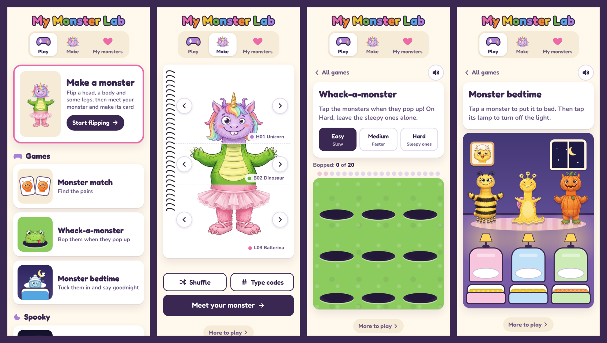

# Monster Lab

A tiny website for young children. Flip a monster's head, body and legs, answer four questions about the monster you made, and get a card to print. Then play games with the monsters.

**Try it:** [monsters.mikeohalloran.au](https://monsters.mikeohalloran.au/)

Built with [Claude](https://claude.ai) in a day, alongside the printed book it goes with.



## The story

I made my daughter a mix-and-match flip book: 30 monsters, each page cut into three strips, so she can flip heads, bodies and legs independently. That's 27,000 monsters in one coil-bound book. The art came from Google AI Studio, the page layout and print files from Python, and the printing from Officeworks.

The book's last page asks four questions about the monster you just made: What's their name? What's their favourite food? Who is their best friend? What makes them grumpy? Her answers deserved somewhere to live, so the book got a website.

The site does the same thing as the book, on a phone:

1. **Flip.** The strips turn over like real pages, by arrow or by swipe. Shuffle picks three at random, or you can type the codes printed on the book's strips (H12, B03, L27).
2. **Meet your monster.** The four questions, with a "make up a name" button for when a young child is stuck.
3. **Make the card.** A picture with the name in rainbow letters, the monster, the answers, the date and the strip codes. Save it, print it, stick it on the fridge.
4. **My monsters.** Every saved monster, on that device, with backup and restore.

A gift copy of the book gets a link like `?for=Max`, and the site becomes Max's Monster Lab.

Then it got things the book can't do: games made from the same 30 monsters. The site opens on the games page, with **Make a monster** as the big first tile and the games beneath it.

- **Monster match.** A memory game. Cards start face down; turn two over, and if they're the same monster they stay. Four levels, from 6 pairs up to all 30 (60 cards).
- **Whack-a-monster.** Monsters pop up out of holes and you bop them. A round is 20 monsters, not a countdown. Hard adds sleepy monsters you have to leave alone, or they wake up grumpy.
- **Monster bedtime.** Your own saved monsters go to bed. Tap one and it hops onto a pillow, under a blanket in the colour and texture of its body; tap its lamp and it starts snoring. When they're all asleep the lights go down, the stars come out and Twinkle Twinkle plays on a music box. No score, no way to lose.

For Halloween, three spooky ones:

- **Torch hunt.** The bedroom's lights are off and monsters are hiding behind the couch, in the toy box, under the bed and behind the curtains. Drag a finger to shine the torch; hold it on a monster and it pops out with a friendly "boo!" and a giggle. Find them all and the lights come on. Easy hides 3, Hard hides 8.
- **Pumpkin face maker.** Tap the pumpkin's eyes, nose or mouth to change them, light it up, save the picture. Then print the face as a carving stencil on A4, at a real size (a 12, 15 or 18 cm face), with a 5 cm bar to check the printer didn't shrink it.
- **Monster masks.** Pick any of the 30 monsters' heads and print it on A4 as a mask to wear: kid size (eye holes 5 cm apart) or grown-up size (6.3 cm), with a grey line to cut along, eye holes, two dots for elastic and the same 5 cm check bar.

Each game has its own link (`/#make`, `/#match`, `/#whack`, `/#bedtime`, `/#torch`, `/#pumpkin`, `/#masks`), and best scores are kept on the device.

The counting and letter games started here too, then outgrew the monster site and moved to their own: the **Learning Lab**, at [learn.mikeohalloran.au](https://learn.mikeohalloran.au/) ([learning-lab](https://github.com/mikeohallo/learning-lab)). Old `/#letters`, `/#count` and `/#quick` links go there.

The three sites sit behind one front door, [play.mikeohalloran.au](https://play.mikeohalloran.au/): Monster Lab (this one), Learning Lab, and Seek Lab, the sister seek-and-find book ([seek-book](https://github.com/mikeohallo/seek-book)). A "More to play" button at the bottom of each site goes back to it.

## How it's built

**It's one HTML file and 120 images.** No framework, no build step, no server, no database, no accounts, no analytics. Hosting is Cloudflare Pages on the free plan, which comfortably covers the handful of families who have the book.

That was the main design decision. The obvious version of this site has user accounts, cloud saves and an API. For a thing used by a handful of families, each of those is a cost, a privacy question and something to maintain. So instead:

- **The monster is assembled in the browser.** The site holds 90 transparent strip images (30 heads, bodies and legs, about 3 MB in total), cut from the real print files so they match the book exactly. Three `` tags stacked in a column are a monster.
- **The card is drawn in the browser** on a canvas: 1200 × 1600 px, with the same fonts and colours as the printed book. Saving it is just saving a PNG.
- **The library lives in `localStorage`.** Each saved monster is three codes, four answers and a date, a couple of hundred bytes. The card is redrawn from the strips every time, so nothing bulky is stored. Backup and restore move the library between devices as a small JSON file.
- **Privacy.** Answers, saved monsters and scores stay in this browser unless you export or share them. The display name is included in personalised links between the sites (a gift link like `?for=Max`, and "More to play" once a name is set), so the hosting service receives it when those links are opened. The page also loads its fonts from Google Fonts. (One more thing moves, once, in a browser set up for the Learning Lab's Letters game: the first time the Learning Lab opens there, this site hands the old saved Letters progress across in the part of the address after the `#`, which browsers don't send to a server.)
- **Not meant for search.** A `noindex` tag asks search engines not to list the site. It's for families with the book, who arrive by QR code, gift link or home-screen icon.

### Things that turned out to matter

- **A page turn, not a fade.** The first version faded between strips. Flipping a real strip in the book turns it over, so the site does the same: a 3D rotate on the strip, hinged at the coil. It's one CSS transform and it made the thing feel like the book.
- **White tummies.** Cutting the monsters out of the print files by colour left the white tummies transparent. The fix was to build a solid silhouette of each monster first, then use that as the alpha mask. Same trick for the printed cut lines that cross pale tummies at the joins.
- **iPhones delete site data.** Safari removes a site's saved data if you don't open it for seven days of Safari use. Adding the site to the Home Screen avoids that. It's why there's a backup button.
- **Nothing to type.** A young child can't type H12, but she can swipe. The codes are the parent's shortcut; the swipe is hers.
- **Nothing to read, either.** Each tab has a picture above its label (a game controller for Play, a monster for Make, a heart for My monsters), and the games page is a set of big pictures, so she can find a game herself. The address follows the tabs, so a reload keeps her where she was.
- **Sounds without sound files.** The boings, the snores and the lullaby are all made in the browser with the Web Audio API, so the games need nothing but the HTML file and the images. There's a mute button, and it's remembered.
- **Make first, then play.** The front page is the games page, but Make a monster is its first and biggest tile, showing whatever monster is on the flip book. Someone arriving from the book is one tap from flipping, and a child who comes back for the games lands on them.
- **A stencil has to be carvable.** A pumpkin face that looks fine on screen can fall apart under a knife. Every eye, nose and mouth combination (144 of them) is checked: teeth, fangs and tongues stay joined to the pumpkin, and no two holes come closer than 9 mm, even on the smallest stencil. The stencil also keeps each face the size it is on the pumpkin: the first version stretched every face to the chosen width, so a one-eyed "Ooh" face came out bigger than the page.

## What's in this repo

| Path | What it is |
|---|---|
| `index.html` | The whole site: markup, styles and script in one file |
| `tools/make_web_strips.py` | Cuts the 90 strip images and 30 face icons from the book's print pages |
| `tools/build_site.py` | Wraps the page for hosting and sets the generic title |
| `tools/test_site.py` | Drives the site in Chromium at phone size: flipping, swiping, codes, saving, deleting, backup, restore, no sideways scroll; any failed step or page error fails the run |
| `tools/test_match.py` | Plays the match game: a wrong pair flips back, a full game ends in a win, the best score sticks, every level fits a phone |
| `tools/test_links.py` | The tab bar fits at 360–430 px; the plain link opens on the games page with Make a monster first; the `#make`, `#match`, `#whack`, `#bedtime` and `#monsters` links and gift links work; and the old Letters and Numbers links go to the Learning Lab |
| `tools/test_games.py` | Plays Whack-a-monster and Monster bedtime with the page clock fast-forwarded: a perfect round, an empty round, a sleepy monster on Hard, a full bedtime from tuck-in to Good morning |
| `tools/test_spooky.py` | Plays Torch hunt at every level by moving the torch onto each monster, and the Pumpkin face maker: changing parts, lighting it, saving the picture, measuring each printed stencil (12, 15 and 18 cm, and the 5 cm bar), and checking all 144 faces fit the page at every size; prints masks at both sizes and checks the eye-hole spacing, and that all 30 heads fit the page with the eye holes and elastic dots on the monster |
| `docs/` | Screenshots |

The monster images aren't in the repo; they're the book. Nor is `site/app.html`, the working copy that `build_site.py` wraps into `index.html`, so that script won't run from a clean clone; `index.html` is its built result and is complete. The image tools and the tests are all here.

## Running it locally

Serve the page rather than opening the file directly. Browsers treat `file://` pages differently from one another (saving to the device and drawing the card can both behave differently or fail), and a local server gives reliable browser behaviour, the same as the real site.

```
python3 -m http.server 8000
```

Then open `http://localhost:8000`. Without the `strips/` and `faces/` folders you'll get the layout with empty frames, which is enough to see how it works.

## Credits

Monster art generated with Google AI Studio. Fonts: [Fredoka](https://fonts.google.com/specimen/Fredoka) and [Nunito](https://fonts.google.com/specimen/Nunito), both Open Font Licence. Site and tools written with Claude.

Made for my daughter.
